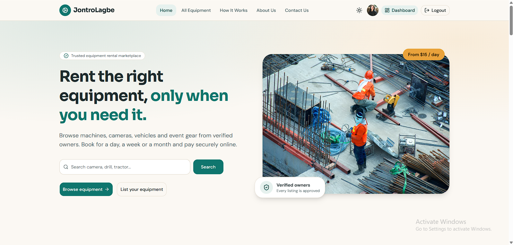
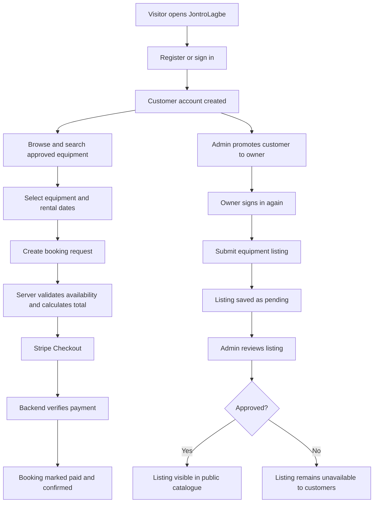

<div align="center">

# JontroLagbe

### Rent the equipment you need. List the equipment you own.

A role-based equipment rental marketplace for discovering, listing, booking, and managing equipment rentals.

[](https://jontrolagbe.vercel.app/)
[](https://github.com/FayroSyrup/JontroLagbe_ClientSide)
[](https://github.com/FayroSyrup/JontroLagbe_ServerSide)

</div>

> **Project preview:** The image below is a temporary placeholder. Replace it with a screenshot of the deployed homepage at `docs/images/homepage.png` and update the image path in this README.

<p align="center">
  
</p>

---

## Overview

**JontroLagbe** is a full-stack equipment rental marketplace that connects people who need equipment with people who have equipment available to rent. Customers can discover approved listings, search and filter the catalogue, save favorites, book equipment for a selected period, and pay through Stripe Checkout. Equipment owners can publish and manage listings, while administrators oversee users, listings, bookings, and platform analytics.

The application uses three roles:

| Role | Main responsibilities |
|---|---|
| **Customer** | Browse approved equipment, save favorites, create bookings, and complete checkout. |
| **Owner** | Add and manage equipment listings and view rentals associated with their equipment. |
| **Admin** | Manage users and roles, review equipment submissions, oversee bookings, and view platform analytics. |

New accounts are created with the **customer** role. An administrator promotes a customer to **owner** when the account is approved to publish equipment. This is intentional: users cannot grant themselves owner or admin permissions during registration.

## Live deployments

| Application | URL |
|---|---|
| **Frontend website** | <https://jontrolagbe.vercel.app/> |
| **Backend API** | <https://jontrolagbe-client.vercel.app/> |
| **Client source code** | <https://github.com/FayroSyrup/JontroLagbe_ClientSide> |
| **Server source code** | <https://github.com/FayroSyrup/JontroLagbe_ServerSide> |

The backend root URL returns a simple health message. The frontend is the public website users should visit.

## Features

### Marketplace

- Browse publicly available, admin-approved equipment.
- Search by equipment name, location, and category.
- Filter by category, rental period, price range, and availability.
- Sort by newest listings or rental price.
- Paginated equipment results and equipment detail pages.
- Equipment categories include construction, photography, vehicles and transportation, agriculture, electronics, and event equipment.

### Customer experience

- Email/password authentication through Better Auth.
- Optional Google sign-in when OAuth credentials are configured.
- Save and remove favorite equipment.
- Create bookings with start date, end date, quantity, contact number, and delivery address.
- View personal booking history and rental status.
- Complete payment through Stripe Checkout.

### Owner experience

- Owner access is granted by an administrator.
- Submit equipment with description, category, location, rental price, rental period, quantity, condition, brand, model, image, and rental terms.
- Upload equipment photos through ImgBB.
- View and manage own listings.
- View paid rentals and owner analytics.
- Owner-submitted listings start as **pending** and must be approved by an administrator before they appear in the public catalogue.

### Administration

- View registered users and manage roles.
- Block or unblock accounts.
- Review pending equipment listings and approve or reject submissions.
- View all equipment and bookings.
- View dashboard analytics, including users, equipment, bookings, revenue, monthly activity, and equipment categories.

### Booking, payment, and automation

- The server calculates rental totals; the client does not set the authoritative price.
- Daily pricing is calculated per day; weekly and monthly pricing use the applicable started rental period.
- Booking requests validate dates, quantity, and available stock for overlapping date ranges.
- Unpaid pending bookings hold stock temporarily (30 minutes in the current implementation).
- Stripe Checkout payment is verified by the backend before a booking is marked paid and confirmed.
- Scheduled booking maintenance marks finished rentals as completed and cancels expired unpaid holds.
- Email notifications can be enabled through the backend email configuration.

## Technology stack

| Area | Technology |
|---|---|
| Framework | Next.js App Router |
| Language | TypeScript |
| UI | React, Tailwind CSS, Base UI, reusable components |
| Authentication | Better Auth |
| Authentication database adapter | Better Auth MongoDB adapter |
| Database | MongoDB Atlas |
| Payments | Stripe |
| Image hosting | ImgBB |
| Charts | Recharts |
| Animation | Framer Motion |
| Icons | Lucide React |
| Deployment | Vercel |

## Application workflow



## Getting started

### Prerequisites

- Node.js **20.9 or newer** (use a current supported LTS release).
- npm.
- A MongoDB Atlas cluster and database user with read/write access.
- A Stripe account and test-mode secret key for payment testing.
- An ImgBB API key for image uploads.
- Google OAuth credentials only if Google sign-in is to be enabled.
- The companion [JontroLagbe server](https://github.com/FayroSyrup/JontroLagbe_ServerSide) running locally or deployed.

### 1. Clone the client repository

```bash
git clone https://github.com/FayroSyrup/JontroLagbe_ClientSide.git
cd JontroLagbe_ClientSide
npm install
```

### 2. Configure environment variables

Create a `.env.local` file in the project root. Do not commit this file.

```env
# Express API base URL
NEXT_PUBLIC_API_BASE_URL=http://localhost:5000

# Better Auth — keep this secret stable across deployments
BETTER_AUTH_SECRET=replace_with_a_long_random_secret
BETTER_AUTH_URL=http://localhost:3000

# Same MongoDB Atlas cluster and database user used by the backend
BETTER_AUTH_DB_URI=mongodb+srv://<DB_USER>:<URL_ENCODED_DB_PASSWORD>@<DB_HOST>/

# Optional Google OAuth credentials
GOOGLE_CLIENT_ID=
GOOGLE_CLIENT_SECRET=

# Stripe test-mode secret key (server-side; never prefix with NEXT_PUBLIC_)
STRIPE_SECRET_KEY=sk_test_replace_me

# ImgBB API key used by browser-side image uploads
NEXT_PUBLIC_IMGBB_API_KEY=replace_with_your_imgbb_api_key
```

Replace every placeholder with your own values. URL-encode special characters in the MongoDB password before placing it in the URI. `BETTER_AUTH_URL` must be the exact origin serving the frontend. Keep the same `BETTER_AUTH_SECRET` when redeploying an application that already has Better Auth records in MongoDB; changing it can make previously encrypted authentication keys unreadable.

`NEXT_PUBLIC_` variables are exposed to the browser bundle. Only use that prefix for values intended to be public, such as the API base URL and ImgBB upload key. Never put database credentials, Better Auth secrets, or Stripe secret keys in a `NEXT_PUBLIC_` variable.

### 3. Start the development server

```bash
npm run dev
```

Open <http://localhost:3000>.

### 4. Build for production

```bash
npm run build
npm run start
```

The available scripts are `dev`, `build`, `start`, and `lint`.

## Connecting to the backend

The client communicates with the Express API through `NEXT_PUBLIC_API_BASE_URL`.

- Local development: `http://localhost:5000`
- Current production API: `https://jontrolagbe-client.vercel.app`

The backend separately verifies Better Auth session tokens and enforces customer, owner, and admin permissions. Configure the backend's `CLIENT_URL` and `BETTER_AUTH_URL` to match the frontend origin.

## Project structure

```text
JontroLagbe_ClientSide/
├── app/                    # App Router pages, layouts, and API routes
│   ├── (auth)/              # Sign-in and registration pages
│   ├── (site)/              # Public marketplace pages
│   ├── api/                 # Better Auth and checkout-related routes
│   └── dashboard/           # Customer, owner, and admin dashboards
├── components/              # Shared UI, forms, cards, navigation, and dashboard components
├── lib/                     # Authentication, API clients, configuration, types, and helpers
├── public/                  # Static assets
├── docs/
│   └── images/              # README screenshots and project images
├── .env.local               # Local secrets (not committed)
├── next.config.ts
├── package.json
└── README.md
```

## Related repository

The Express API, MongoDB data operations, role middleware, booking logic, Stripe payment verification, analytics, and scheduled tasks are maintained separately:

**[JontroLagbe_ServerSide](https://github.com/FayroSyrup/JontroLagbe_ServerSide)**

## Screenshots

Add genuine screenshots of the deployed application to `docs/images/` and link them here. Suggested captures:

- `homepage.png` — homepage at desktop width.
- `equipment-list.png` — search and filter results.
- `equipment-details.png` — equipment details and booking entry point.
- `customer-dashboard.png` — customer rental history.
- `owner-dashboard.png` — owner equipment management.
- `admin-dashboard.png` — admin overview and approvals.

## Security notes

- Never commit `.env`, `.env.local`, API keys, access tokens, passwords, or database credentials.
- Keep the Better Auth secret stable for an existing database.
- The backend must enforce authorization; hiding a UI control is not a security boundary.
- Use Stripe test keys for development and test transactions.
- Use strong MongoDB database credentials and restrict Atlas network access appropriately for the deployment environment.

## Copyright and usage

Copyright © 2026 **Fayroz Tasnim Rowza**. All rights reserved.

This repository is provided for academic, educational, and portfolio demonstration purposes. No license is granted for commercial reuse, redistribution, or republishing of this project without prior written permission from the copyright holder. Third-party dependencies and assets remain subject to their respective owners' licenses and terms.

---

<div align="center">

**JontroLagbe — Rent smarter. Use what you need.**

</div>
